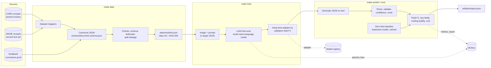
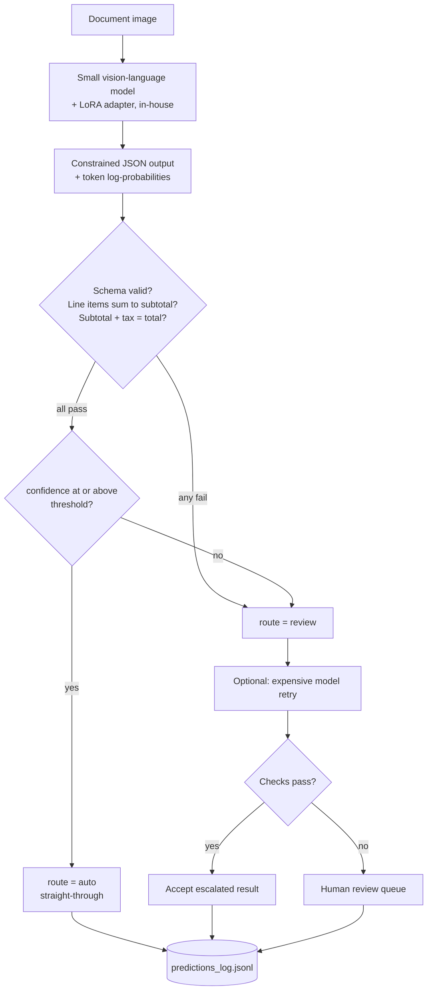
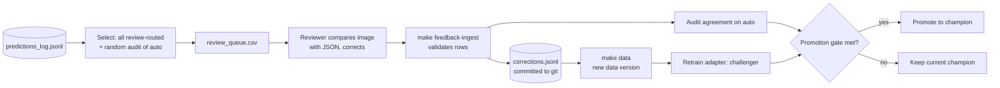
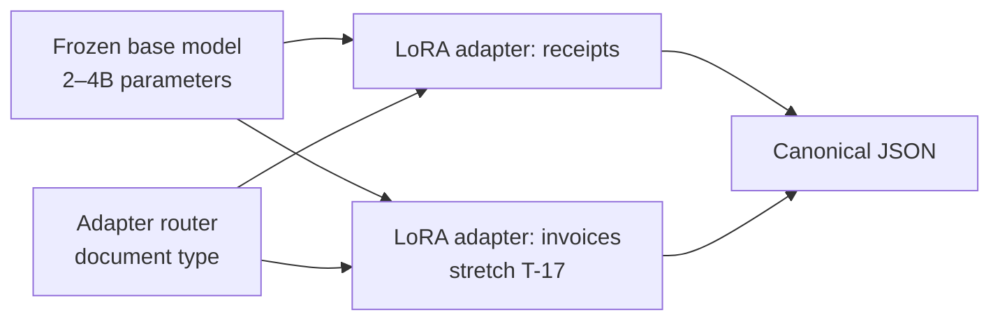
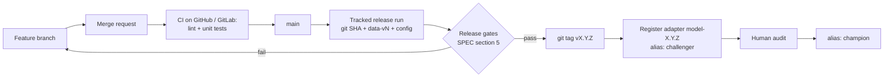
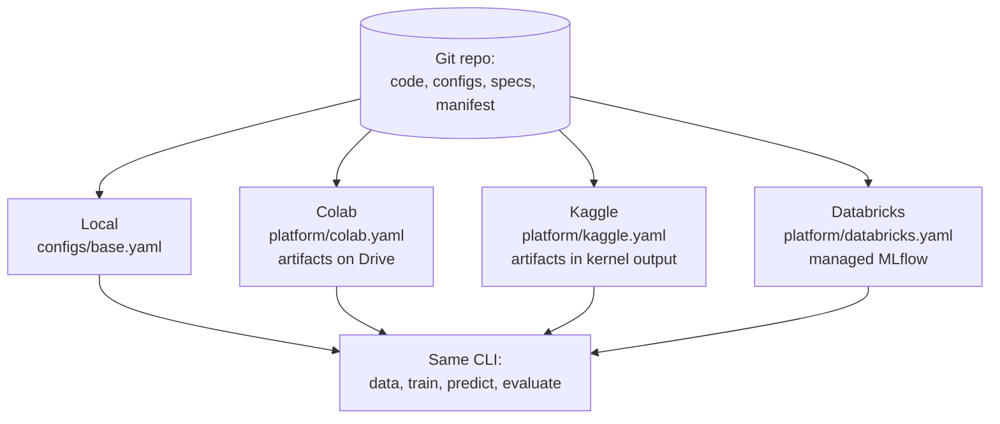

# Architecture — Invoice and Receipt Extraction

The diagrams are Mermaid and render on GitHub and GitLab.

## 1. Training and evaluation pipeline
What `make data train predict eval` does, and what each step writes.

## 2. Inference path: extract, check, route
How one document is handled at run time.

## 3. Human feedback loop

## 4. Model composition
One frozen base model, small trainable adapters. The stretch task adds a second adapter and a router.

## 5. Versioning and release flow

## 6. Where it runs

